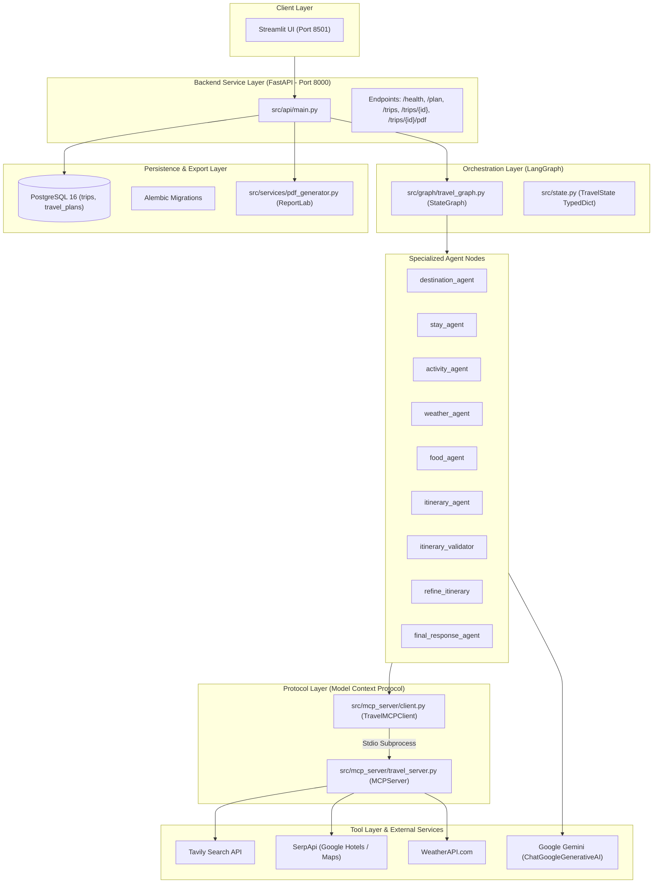

# 📖 Module 1: The AI Travel Planner Project Story

> **Purpose:** This document provides a complete, cohesive, professional English narrative of the AI Travel Planner system. It connects the business problem to the software engineering decisions, agent architecture, execution mechanics, failure modes, and interview takeaways.

---

## 1. Project Overview

### What is AI Travel Planner?
**AI Travel Planner — Multi-Agent Travel Planning System** is an autonomous, agentic AI backend application engineered to eliminate the manual friction of trip planning. Rather than relying on a single generic LLM prompt, the system employs a **multi-agent orchestration architecture** powered by **LangGraph**, where specialized agents handle destination discovery, lodging research, activity selection, weather evaluation, and local dining.

### The Concrete User Journey (Illustrative Goa Trip)
Consider a traveler planning a 4-day vacation to Goa, India:
- **User Inputs**: Destination (`"Goa"`), Dates (`"2026-11-10 to 2026-11-13"`), Duration (`4 days`), Travelers (`2`), Budget (`₹40,000`), and Preferences (`["beaches", "food", "relaxation"]`).
- **System Execution**:
  1. The system assesses Goa's geographic layout and identifies suitable clusters (e.g., North Goa vs. South Goa).
  2. It concurrently queries live hotel rates (via Google Hotels), attraction locations (via Google Maps), and forecast weather.
  3. It retrieves highly-rated coastal dining spots.
  4. It synthesizes this research into an ordered, day-by-day itinerary.
  5. It runs algorithmic and model-based checks to ensure places exist, are not duplicated, and do not require cross-state zigzagging.
  6. If inconsistencies are found, an automated repair agent refines the schedule within a bounded retry loop.
- **System Outputs**: A validated day-by-day itinerary, accommodation recommendations, dining suggestions, budget analysis, practical travel tips, relational database persistence, and an in-memory downloadable PDF document.

### Why is this "Agentic AI" rather than a Simple LLM Chatbot?
In a standard chatbot or "LLM wrapper", a prompt like *"Plan me a 4-day Goa trip"* is sent to an LLM. The LLM guesses hotel names, invents fictional room rates, hallucinates restaurant locations, and combines attractions that are hours apart.

In contrast, **AI Travel Planner is an Agentic System** because:
1. **Decoupled Roles**: It decomposes a complex goal into discrete sub-problems handled by specialized agents.
2. **Environment Grounding**: Agents do not invent data; they execute tool calls over the **Model Context Protocol (MCP)** to fetch real-world search results from Tavily, SerpApi, and WeatherAPI.
3. **Structured State Machine**: It coordinates tasks using a directed cyclic graph (LangGraph) with parallel forks, synchronization joins, and conditional routing.
4. **Self-Correction & Bounded Loops**: It does not assume its first draft is correct. It inspects its own output against deterministic rules and refines errors in a closed feedback loop.

---

## 2. Problem Statement

Manual travel planning is notoriously fragmented:
1. **Source Dispersal**: Travelers must juggle hotel booking portals, mapping engines, weather forecasts, blogs, and restaurant review sites simultaneously.
2. **Domain Disparity**: Lodging requires pricing and location filters; activities require opening hours and category alignment; weather dictates indoor vs. outdoor scheduling.
3. **Synthesis Cognitive Load**: Combining these distinct data points into a geographically practical itinerary is mentally exhausting.
4. **LLM Hallucinations & Geographic Contradictions**: When travelers turn to standard AI chatbots, they encounter severe failure modes:
   - *Hallucinated entities*: Closed attractions or imaginary hotels.
   - *Geographic inconsistency*: Scheduling an attraction in North Goa (Arambol) at 10:00 AM, a restaurant in South Goa (Palolem) at 1:00 PM (a 3-hour drive), and returning to North Goa for sunset.
   - *Budget disconnection*: Claiming a luxury resort fits a ₹5,000/night budget without verifying live rates.
   - *Duplicate visits*: Scheduling the same tourist spot on multiple days to fill time slots.

---

## 3. Project Objectives

The project set out to achieve specific architectural milestones:

| Objective | Target Scope | Current Status in Codebase |
|---|---|---|
| **Specialized Agent Decomposition** | Discrete agents for Destination, Stay, Activity, Weather, Food, Itinerary, Validation, Refinement, and Response. | ✅ **Fully Implemented** |
| **Real-World Tool Grounding** | Integrating live search engines via Model Context Protocol (MCP). | ✅ **Fully Implemented** *(Ephemeral subprocess model)* |
| **Strict Type Safety** | Pydantic validation on all agent outputs and API payloads. | ✅ **Fully Implemented** |
| **Automated Verification & Repair** | Evaluating grounding, duplicates, and geographic routing with bounded loops. | 🟡 **Partially Implemented** *(Geographic checks hardcoded to Goa)* |
| **Enterprise Persistence** | Relational storage for requests and plans with Alembic schema versioning. | ✅ **Fully Implemented** |
| **RESTful Service Delivery** | FastAPI backend with endpoints for generation, retrieval, and PDF export. | ✅ **Fully Implemented** *(Synchronous execution)* |
| **Document Export** | In-memory ReportLab PDF generation streaming directly to clients. | ✅ **Fully Implemented** *(Needs XML escaping hardening)* |

---

## 4. Proposed Solution & Multi-Agent Rationale

### Why Multi-Agent Separation of Concerns?
In software engineering, the **Single Responsibility Principle (SRP)** dictates that a module should have one reason to change. The same principle applies to AI Engineering:

1. **Prompt Isolation**: An LLM prompt trying to simultaneously find hotels, evaluate rain probability, pick restaurants, design an itinerary, and check budgets becomes diluted and prone to instruction-following failures.
2. **Specialized Schemas**: A `StayAnalysis` schema requires room rates and addresses, while a `WeatherAnalysis` schema requires temperatures and rain chances. Separating agents enables targeted Pydantic schemas.
3. **Parallel Concurrency**: Lodging, attractions, and weather research do not depend on each other. Running them in parallel reduces overall wall-clock latency compared to sequential single-prompt execution.
4. **Adversarial Validation**: An agent that creates a plan has inherent bias toward defending its creation. Introducing a separate `itinerary_validator` and `refine_itinerary` agent establishes an objective quality gate.

---

## 5. End-to-End User Request Walkthrough

Let us trace a user request step-by-step through the actual codebase:

```text
User Request ──► FastAPI (/plan) ──► Insert Trip (DB: "planning") ──► LangGraph.invoke()
  ──► destination_agent ──► [Parallel Fork] ──► stay / activity / weather
  ──► [Join Barrier] ──► food_agent ──► itinerary_agent ──► itinerary_validator
  ──► Conditional Route:
        ├─► is_valid == True ──► final_response_agent ──► DB: "completed" ──► 200 OK
        ├─► is_valid == False (attempts < 3) ──► refine_itinerary ──► validator
        └─► attempts >= 3 ──► validation_failed ──► DB: "completed" ──► 200 OK
```

### Trace Details:
1. **HTTP Ingestion**: Client submits JSON to `POST /plan`. FastAPI parses it into `TravelRequest` ([`src/api/schemas.py`](../src/api/schemas.py)).
2. **Initial Persistence**: `create_trip` ([`src/database/repository.py`](../src/database/repository.py)) writes a new record to the `trips` table with `status="planning"`.
3. **Graph Initialization**: `run_travel_planner` instantiates `TravelState` and calls `graph.invoke(state, config=config)`.
4. **Destination Research**: `destination_agent` calls Tavily search via MCP, extracting key areas and travel considerations into `DestinationAnalysis`.
5. **Parallel Research**: LangGraph branches simultaneously to:
   - `stay_agent`: Queries Google Hotels via SerpApi for nightly rates.
   - `activity_agent`: Queries Google Maps via SerpApi for attractions.
   - `weather_agent`: Queries WeatherAPI for forecast temperatures and rain chances.
6. **Barrier Synchronization**: LangGraph pauses until all three parallel agents finish, then activates `food_agent`.
7. **Food Research**: `food_agent` queries Google Maps via SerpApi for local restaurants matching price levels.
8. **Itinerary Synthesis**: `itinerary_agent` receives all research and generates a structured day-by-day `ItineraryAnalysis`.
9. **Hybrid Validation**: `itinerary_validator` inspects the plan:
   - LLM checks schedule pacing and preferences.
   - Pure Python functions verify no duplicate places, all places exist in research, and locations are geographically coherent.
10. **Refinement or Failure Branching**:
    - If valid, proceeds to `final_response_agent`.
    - If invalid and attempts < 3, `refine_itinerary` repairs duplicate/geographic errors and re-triggers validation.
    - If invalid and attempts reach 3, `validation_failed` catches the failure and returns a safe fallback plan.
11. **Final Packaging**: `final_response_agent` compiles the validated plan into `FinalResponse`.
12. **Database Finalization**: `save_travel_plan` stores the plan in `travel_plans` table; `update_trip_status` updates trip to `status="completed"`.
13. **Client Delivery & PDF**: API returns JSON `TravelPlanResponse`. The user can immediately request a downloadable PDF via `GET /trips/{trip_id}/pdf`.

---

## 6. Architecture & System Layers



### Explanation of Core System Layers:
- **FastAPI Layer**: Exposes REST interfaces, validates HTTP payloads via Pydantic, and manages database session boundaries.
- **LangGraph Orchestrator**: Manages state transitions, parallel forks, join synchronization, and cyclic refinement loops.
- **Pydantic Schema Layer**: Enforces strict typing between LLM outputs and Python runtime objects.
- **Model Context Protocol (MCP)**: Encapsulates search and data-retrieval tools behind standardized JSON-RPC protocols.
- **PostgreSQL & SQLAlchemy Layer**: Persists request metadata, status lifecycles, and plan JSONB payloads with Alembic tracking.
- **PDF Generation Layer**: Builds formatted, styled printable itineraries in memory using ReportLab.
- **LangSmith Tracing**: Captures workflow tags and execution metadata for observability.

---

## 7. Agent Responsibilities

### 1. Destination Agent ([`src/agents/destination_agent.py`](../src/agents/destination_agent.py))
- **Role**: Discovers broad geographic areas, local culture, and high-level considerations.
- **Tools**: `destination_research_tool` (Tavily search via MCP).
- **Output Schema**: `DestinationAnalysis` (overview, recommended areas, travel considerations).

### 2. Stay Agent ([`src/agents/stay_agent.py`](../src/agents/stay_agent.py))
- **Role**: Finds verified accommodations fitting the traveler's budget and dates.
- **Tools**: `accommodation_search_tool` (SerpApi Google Hotels via MCP).
- **Output Schema**: `StayAnalysis` (list of `Accommodation` objects with nightly rates, ratings, and locations).

### 3. Activity Agent ([`src/agents/activity_agent.py`](../src/agents/activity_agent.py))
- **Role**: Finds attractions, sightseeing spots, and activities aligned with traveler preferences.
- **Tools**: `activity_search_tool` (SerpApi Google Maps via MCP).
- **Output Schema**: `ActivityAnalysis` (list of `Activity` objects categorized with descriptions).
- **Known Limitation**: Because Google Maps lacks ticket pricing, costs are defaulted to `0.0`.

### 4. Weather Agent ([`src/agents/weather_agent.py`](../src/agents/weather_agent.py))
- **Role**: Retrieves forecast conditions to ensure outdoor plans match the weather.
- **Tools**: `weather_search_tool` (WeatherAPI via MCP).
- **Output Schema**: `WeatherAnalysis` (temperatures, precipitation probability, recommendations).

### 5. Food Agent ([`src/agents/food_agent.py`](../src/agents/food_agent.py))
- **Role**: Discovers highly rated restaurants and culinary experiences.
- **Tools**: `restaurant_search_tool` (SerpApi Google Maps via MCP).
- **Output Schema**: `FoodAnalysis` (list of `Restaurant` objects categorized by cuisine).

### 6. Itinerary Agent ([`src/agents/itinerary_agent.py`](../src/agents/itinerary_agent.py))
- **Role**: Pure planning synthesis agent. Organizes research into an ordered day-by-day schedule.
- **Tools**: None (consumes `TravelState` directly).
- **Output Schema**: `ItineraryAnalysis` (list of `ItineraryItem` objects with Day, Time, Activity, Location).

### 7. Itinerary Validator ([`src/agents/itinerary_validator.py`](../src/agents/itinerary_validator.py))
- **Role**: Quality gatekeeper. Evaluates itinerary grounding, duplicates, and geography.
- **Mechanics**: Combines LLM structured evaluation with deterministic Python checks (`src/utils/itinerary_checks.py`).
- **Output Schema**: `ItineraryValidation` (`is_valid`, `issues`, `feedback`).

### 8. Refine Itinerary Agent ([`src/agents/refine_itinerary.py`](../src/agents/refine_itinerary.py))
- **Role**: Repairs flawed itineraries when validation fails.
- **Mechanics**: Prompts Gemini with specific validation issues and applies deterministic algorithmic safety nets.
- **Output Schema**: Repaired `ItineraryAnalysis`.

### 9. Final Response Agent ([`src/agents/final_response_agent.py`](../src/agents/final_response_agent.py))
- **Role**: Formats the validated plan into a cohesive, user-friendly presentation document.
- **Output Schema**: `FinalResponse` (trip summary, itinerary, lodging summary, dining summary, travel tips).

---

## 8. Technology Choices & Trade-offs

| Technology | Purpose in Project | Why Chosen | Architectural Trade-off |
|---|---|---|---|
| **LangGraph** | Multi-Agent Orchestrator | Native support for cycles, state management, parallel forks, and bounded loops. | Steeper learning curve than linear LangChain chains; requires explicit state schemas. |
| **Google Gemini** | Core Reasoning LLM | Generous API limits, fast response times, native structured output support. | Occasional tool-calling inconsistency requiring validation layers. |
| **Pydantic v2** | Schema Validation | Rust-accelerated type safety, strict JSON parsing, seamless FastAPI integration. | Extra schema maintenance overhead across 8+ models. |
| **FastAPI** | REST API Backend | High-performance asynchronous routing, automatic OpenAPI Swagger documentation. | Currently runs long-running LLM workflows synchronously inside HTTP handlers. |
| **Model Context Protocol (MCP)** | Tool Layer Decoupling | Standardized protocol separating agent reasoning from tool implementation. | Subprocess stdio spawning per call incurs latency overhead. |
| **PostgreSQL 16** | Relational Database | ACID transactions, foreign keys, and native JSONB support for semi-structured itineraries. | Requires external database server unlike embedded SQLite. |
| **SQLAlchemy 2.0** | Object-Relational Mapper | Modern declarative typing (`Mapped[...]`), connection pooling, clean session lifecycle. | Complex query syntax compared to raw SQL or lightweight query builders. |
| **Alembic** | Schema Migrations | Safe, version-controlled schema evolution for production database integrity. | Requires manual execution step (`alembic upgrade head`) during initial setup. |
| **ReportLab** | Document Generation | Programmatic in-memory PDF generation without writing temporary files to disk. | Strict XML parser crashes on unescaped characters (`&`, `<`, `>`). |
| **Tavily Search** | Destination Web Research | Built specifically for AI agents, returning clean markdown snippets without HTML noise. | Third-party paid quota dependency. |
| **SerpApi** | Hotels & Maps Scraping | Extracts live Google Hotels and Google Maps data reliably without custom scrapers. | High latency (~2–4s per query) and hardcoded INR/India localization defaults. |

---

## 9. Important Engineering Decisions

1. **Multi-Agent Decomposition over Monolithic Prompts**:
   - *Decision*: Separate research into distinct agents.
   - *Rationale*: A single prompt researching hotels, attractions, weather, and food simultaneously exceeds effective context recall and frequently hallucinates. Specialized agents produce verified, focused data blocks.
2. **Deterministic Safety Nets Alongside LLM Validation**:
   - *Decision*: Implement Python heuristic checks (`find_ungrounded_itinerary_places`, `find_duplicate_itinerary_places`) in addition to LLM validation.
   - *Rationale*: LLMs are notoriously lenient validators of their own output. Deterministic set-difference checks catch exact entity omissions that LLMs overlook.
3. **Bounded Refinement Loop (`MAX_VALIDATION_ATTEMPTS = 3`)**:
   - *Decision*: Hardcap refinement iterations at 3 attempts.
   - *Rationale*: Without a ceiling, circular validation failures (e.g., repairing one error only to introduce another) result in infinite loops, burning API quotas and freezing the application.
4. **Relational + JSONB Hybrid Storage**:
   - *Decision*: Store trip metadata (`destination`, `budget`, `dates`) in relational columns and travel plans in PostgreSQL `JSONB`.
   - *Rationale*: Enables fast relational querying and indexing on trip records while allowing the flexible, nested structure of daily itineraries to evolve without schema churn.

---

## 10. Error Handling and Failure Scenarios

| Failure Scenario | Current Behavior in Code | Architectural Risk | Recommended Resolution |
|---|---|---|---|
| **Missing `DATABASE_URL`** | Crashes on module import with unhandled `ValueError`. | Application fails to start. | Provide lazy connection factory or default development fallback. |
| **External API Rate Limit / Failure** | Tool raises `requests.HTTPError` via `raise_for_status()`. | Workflow aborts immediately; trip marked `status="failed"`. | Add exponential backoff retries (`tenacity`) and fallback mock data. |
| **Model Fails to Call Tool** | Agent raises `ValueError("... agent did not call the ... tool.")`. | Workflow crashes ungracefully. | Fallback to deterministic tool invocation or direct LLM prompting. |
| **Validation Fails 3 Times** | Graph routes to `validation_failed`, returning controlled warning plan. | Handled gracefully in graph, but API still marks `status="completed"`. | Update trip status to `"completed_with_warnings"`. |
| **Invalid Travel Dates Input** | Tool crashes on `split("to")`, returning HTTP 500 error. | Poor user experience and raw exception leakage. | Validate `travel_dates` in Pydantic schema returning HTTP 422. |
| **PDF Special Character Crash** | ReportLab XML parser crashes on unescaped `&` or `<`. | PDF download returns HTTP 500. | Apply `html.escape()` to all dynamic strings before PDF rendering. |

---

## 11. Security Posture

### Current Protections:
- **Zero Committed Secrets**: `.env` is excluded in both `.gitignore` and `.dockerignore`.
- **Database Parameterization**: SQLAlchemy ORM prevents SQL injection vulnerabilities.
- **Pydantic Request Validation**: Rejects malformed payload types before workflow execution.

### Identified Security Gaps (Recommendations):
- **Missing API Authentication**: Endpoints `/plan` and `/trips` are unauthenticated; anyone on the network can trigger expensive LLM queries. *Recommendation*: Add API key or JWT header guards.
- **Exception Leakage**: FastAPI returns `detail=f"Travel planning failed: {exc}"`, leaking internal stack traces in HTTP 500 responses. *Recommendation*: Mask internal errors behind generic messages.
- **Missing Rate Limiting**: No rate limits exist on `/plan`. *Recommendation*: Add `slowapi` rate-limiting middleware.
- **Container Privilege**: Docker container runs as `root`. *Recommendation*: Run as non-root service user (`USER appuser`).

---

## 12. Engineering Challenges & Trade-offs

1. **State Synchronization in Parallel Branches**:
   - Coordinating concurrent research branches (`stay`, `activity`, `weather`) without overwriting keys required designing `TravelState` with completely disjoint output dictionary keys.
2. **Bridging Async MCP to Synchronous Agents**:
   - The official MCP Python SDK is inherently asynchronous (`asyncio`). However, LangChain tool bindings in standard workflows run synchronously. Bridging them via `asyncio.run()` works in background worker threads but introduces subprocess spawning overhead.
3. **Balancing LLM Creativity vs Grounding**:
   - Prompting the Itinerary Agent to be strictly grounded in research occasionally led to empty schedules if research returned few places. Adding deterministic repair algorithms solved empty slots without allowing ungrounded hallucinations.

---

## 13. Current Limitations Summary

*(For the complete technical breakdown, see [`06-known-limitations-and-tradeoffs.md`](06-known-limitations-and-tradeoffs.md).)*

- **Goa-Specific Geographic Logic**: Geographic validation checks explicitly return early for destinations other than `"goa"`.
- **Subprocess Spawning in MCP**: Spawns a new Python process per tool call instead of maintaining a persistent client connection.
- **Attraction Costs Defaulted to Free**: Missing Google Maps ticket prices are forced to `0.0`.
- **Synchronous Long-Running HTTP Blocking**: Clients must hold an open HTTP connection for 30–90 seconds while the graph runs.
- **Unmocked Automated Tests**: Test suite invokes live Gemini and SerpApi APIs, consuming quota during test runs.

---

## 14. Project Outcome & Value Demonstrated

The AI Travel Planner demonstrates advanced competencies required of a Senior AI Engineer:
- **Complex Orchestration**: Multi-agent state machines with loops, branching, and barrier joins using LangGraph.
- **Production AI Patterns**: Structured output enforcing, tool grounding, hybrid deterministic validation, and bounded self-correction.
- **Systems Engineering**: Relational persistence, database schema migrations, REST API design, and container orchestration.

---

## 15. Interview-Ready Project Explanations

### 30-Second Elevator Pitch
> *"I designed and built the AI Travel Planner, a multi-agent backend system powered by LangGraph that solves the fragmentation of travel planning. Instead of relying on a single hallucination-prone prompt, the architecture coordinates specialized agents for destination, lodging, weather, activities, and dining. Agents fetch live real-world data through the Model Context Protocol (MCP) using Tavily, SerpApi, and WeatherAPI. The system enforces strict Pydantic structured outputs, implements a hybrid validation and bounded refinement loop to catch duplicate or geographically inconsistent plans, and persists trips in PostgreSQL with full PDF export capabilities."*

### 1-Minute Architectural Overview
> *"Traditional AI travel planners suffer from severe hallucinations—inventing nonexistent hotel prices, clustering attractions across opposite ends of a region, or booking outdoor events during monsoon forecasts. To solve this, I built a modular multi-agent architecture orchestrated by LangGraph. 
> 
> When a request arrives via FastAPI, the workflow forks into parallel research branches: Stay, Activity, and Weather agents query live data via MCP tools while the Destination agent establishes regional context. These results join at a Food agent and flow into an Itinerary synthesis agent. 
> 
> What makes the system robust is its quality gate: an Itinerary Validator combines model evaluation with deterministic Python algorithms to detect ungrounded places, duplicate visits, and geographic transit conflicts. If invalid, a Refinement agent repairs the plan, bounded by a strict 3-attempt ceiling to prevent infinite loops. The final plan is persisted in PostgreSQL via SQLAlchemy and can be downloaded as an in-memory PDF."*

### 2-Minute Deep-Dive Pitch
> *"My goal with the AI Travel Planner was to demonstrate how modern Agentic AI can solve complex, multi-domain optimization problems through separation of concerns. 
> 
> The core architecture is a directed cyclic graph built on LangGraph. I avoided monolithic prompting because travel planning spans distinct sub-problems: hotel rates require pricing filters, activities require spatial awareness, and weather requires temporal forecasting. 
> 
> In our graph, once the Destination Agent finishes initial research, the workflow triggers parallel execution of Stay, Activity, and Weather agents. To standardize tool communication, I integrated the Model Context Protocol (MCP), exposing tools for SerpApi Google Hotels, Google Maps, Tavily, and WeatherAPI. The parallel research branches synchronize at a barrier join before restaurant discovery, feeding structured Pydantic models into a dedicated planning agent.
> 
> The most critical engineering challenge was quality control. LLMs are notoriously poor at validating their own spatial and temporal logic. I implemented a hybrid validation layer: the validator uses Gemini for holistic pacing while running deterministic set operations to catch ungrounded places and duplicate attractions. If flaws are found, conditional edges route the state to an Itinerary Refinement agent, incrementing a retry counter with a hard ceiling of three attempts to prevent infinite API cost recursion.
> 
> On the backend, FastAPI handles synchronous REST requests, SQLAlchemy 2.0 manages PostgreSQL transactions with Alembic migrations, and ReportLab streams in-memory PDFs. While the prototype currently has known trade-offs—such as geographic heuristics currently hardcoded for Goa and synchronous HTTP request blocking—it showcases a resilient, self-correcting agentic architecture ready for asynchronous production hardening."*
