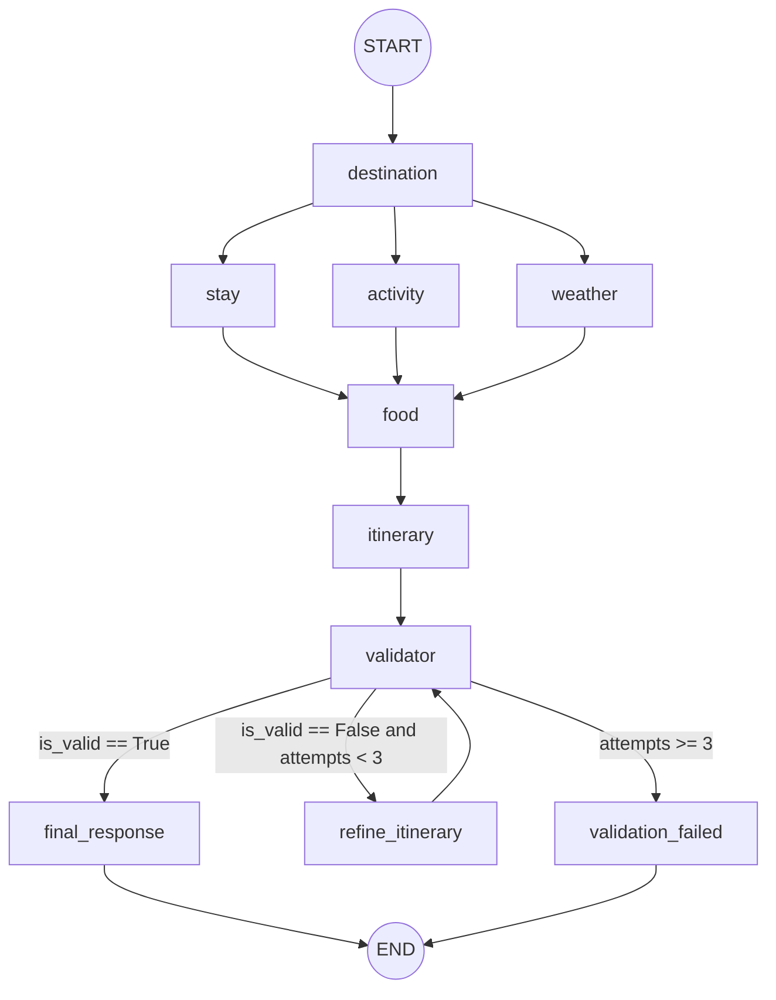

# 🔬 Module 3: Backend & AI Engineering Technical Deep-Dive

> **Scope**: This document provides an exhaustive, code-level technical breakdown of the AI Travel Planner backend. It deliberately excludes frontend implementation details to focus exclusively on **Orchestration, Distributed Agent States, Pydantic Structured Outputs, MCP Protocols, Relational Persistence, and Heuristic Validation Mechanics**.

---

## 1. LangGraph Workflow & State Machine Mechanics

The core orchestration engine is implemented in [`src/graph/travel_graph.py`](../src/graph/travel_graph.py) using `langgraph.graph.StateGraph`.

### 1.1 StateGraph Construction
```python
def build_travel_graph():
    graph = StateGraph(TravelState)

    # 1. Register Nodes
    graph.add_node("destination", destination_agent)
    graph.add_node("stay", stay_agent)
    graph.add_node("activity", activity_agent)
    graph.add_node("weather", weather_agent)
    graph.add_node("food", food_agent)
    graph.add_node("itinerary", itinerary_agent)
    graph.add_node("validator", itinerary_validator)
    graph.add_node("refine_itinerary", refine_itinerary)
    graph.add_node("final_response", final_response_agent)
    graph.add_node("validation_failed", validation_failed)

    # 2. Sequential & Parallel Edges
    graph.add_edge(START, "destination")
    graph.add_edge("destination", "stay")
    graph.add_edge("destination", "activity")
    graph.add_edge("destination", "weather")

    # 3. Synchronization Join (Fan-In Barrier)
    graph.add_edge("stay", "food")
    graph.add_edge("activity", "food")
    graph.add_edge("weather", "food")

    graph.add_edge("food", "itinerary")
    graph.add_edge("itinerary", "validator")

    # 4. Conditional Edge & Loops
    graph.add_conditional_edges(
        "validator",
        route_after_validation,
        {
            "valid": "final_response",
            "invalid": "refine_itinerary",
            "max_attempts": "validation_failed",
        },
    )

    graph.add_edge("refine_itinerary", "validator")
    graph.add_edge("final_response", END)
    graph.add_edge("validation_failed", END)

    return graph.compile()
```

### 1.2 Workflow Execution Topology


### 1.3 Routing Mechanics & Loop Safety
The conditional router [`route_after_validation`](../src/graph/travel_graph.py#L18-L44) evaluates two properties from state:
```python
MAX_VALIDATION_ATTEMPTS = 3

def route_after_validation(state: TravelState) -> str:
    validation = state.get("validation", {})
    attempts = state.get("validation_attempts", 0)

    if validation.get("is_valid", False):
        return "valid"
    if attempts >= MAX_VALIDATION_ATTEMPTS:
        return "max_attempts"
    return "invalid"
```
- **Loop Invariant**: Every execution of `itinerary_validator` increments `validation_attempts` by 1.
- **Termination Guarantee**: The graph is provably finite. Regardless of model output quality, the maximum number of validation passes is strictly bounded to 3.

---

## 2. Shared State Architecture

The shared state is defined in [`src/state.py`](../src/state.py) as a `TypedDict` with optional keys (`total=False`):

```python
class TravelState(TypedDict, total=False):
    # Ingestion Keys (User Request)
    destination: str
    travel_dates: str
    duration: int
    travelers: int
    budget: float
    preferences: list[str]

    # Agent Output Keys
    destination_data: DestinationAnalysis # dict at runtime
    stay_options: StayAnalysis           # dict at runtime
    activities: ActivityAnalysis         # dict at runtime
    weather: WeatherAnalysis             # dict at runtime
    restaurants: FoodAnalysis            # dict at runtime
    itinerary: dict
    validation: dict
    validation_attempts: int
    final_response: dict
```

### 2.1 State Merge Semantics in Parallel Branches
- In LangGraph, when nodes run in parallel (`stay`, `activity`, `weather`), they return partial state dictionaries:
  - `stay_agent` returns `{"stay_options": ...}`
  - `activity_agent` returns `{"activities": ...}`
  - `weather_agent` returns `{"weather": ...}`
- Because these keys are completely disjoint, LangGraph merges them into the root `TravelState` without conflict.
- **Architectural Caveat**: `TravelState` does not use `Annotated[..., Reducer]` channels. If two parallel nodes returned updates to the same key, an unhandled overwrite would occur.

---

## 3. Agent Design Patterns & LLM Invocation

Each of the 5 research agents follows an identical two-stage invocation pattern:

```text
Prompt Construction ──► Stage 1: llm.bind_tools([tool]).invoke() 
    ──► Check tool_calls ──► Execute Tool ──► Stage 2: structured_llm.invoke() 
    ──► Model Dump to State Dict
```

### 3.1 Code Inspection: `stay_agent.py`
```python
def stay_agent(state: TravelState) -> TravelState:
    llm = get_llm()
    llm_with_tools = llm.bind_tools([accommodation_search_tool])
    
    # 1. First LLM Call: Generate tool call
    prompt = build_stay_prompt(state)
    user_message = HumanMessage(content=prompt)
    response = llm_with_tools.invoke([user_message])

    if not response.tool_calls:
        raise ValueError("Stay agent did not call the accommodation search tool.")

    # 2. Tool Invocation via MCP
    tool_call = response.tool_calls[0]
    tool_result = accommodation_search_tool.invoke(tool_call["args"])

    tool_message = ToolMessage(
        content=str(tool_result),
        tool_call_id=tool_call["id"],
    )

    # 3. Second LLM Call: Structured Output Extraction
    structured_llm = get_structured_llm(StayAnalysis)
    final_response = structured_llm.invoke([user_message, response, tool_message])

    return {"stay_options": final_response.model_dump()}
```

### 3.2 Redundancy & Failure Mode Analysis
1. **Redundant Roundtrips**: Stage 1 asks Gemini to generate tool arguments (`destination`, `budget`, `dates`) that are already explicitly present in `TravelState`. This burns an extra LLM roundtrip (~1.5s latency).
2. **Brittle Tool Guard**: `if not response.tool_calls: raise ValueError(...)`. If Gemini answers directly with natural language instead of triggering the tool, the workflow crashes with an uncaught exception.

---

## 4. Pydantic Schemas & Structured Output

Model initialization is centralized in [`src/services/llm.py`](../src/services/llm.py):
```python
def get_structured_llm(schema: type[BaseModel]):
    llm = get_llm()
    return llm.with_structured_output(schema)
```

### 4.1 Schema Overview ([`src/schemas/`](../src/schemas/))
- **`DestinationAnalysis`**: `overview: str`, `recommended_areas: list[str]`, `travel_considerations: list[str]`.
- **`StayAnalysis`**: `recommended_area: str`, `accommodation_options: list[Accommodation]`, `budget_assessment: str`.
- **`ActivityAnalysis`**: `recommended_activities: list[Activity]`, `activities_by_category: dict[str, list[str]]`.
- **`FoodAnalysis`**: `recommended_restaurants: list[Restaurant]`, `restaurants_by_category: dict[str, list[str]]`.
- **`ItineraryAnalysis`**: `itinerary: list[ItineraryItem]`, `total_days: int`, `budget_assessment: str`.
- **`ItineraryValidation`**: `is_valid: bool`, `issues: list[str]`, `feedback: str`.
- **`FinalResponse`**: `destination: str`, `trip_summary: str`, `itinerary: list[dict]`, `accommodation_summary: str`, `food_summary: str`, `travel_tips: list[str]`.

### 4.2 Schema Compliance vs. Factual Grounding
> [!IMPORTANT]
> **Key Concept**: Pydantic guarantees that the output matches the required JSON shape and field types. It does **not** guarantee factual truth. An LLM can emit a syntactically perfect `Accommodation(name="Fictional Beach Villa", price_per_night=500.0)` that passes Pydantic validation completely while remaining a 100% hallucination. This is precisely why the project requires a separate deterministic validation stage.

---

## 5. Model Context Protocol (MCP) Deep-Dive

The repository uses the official Python MCP SDK (`mcp` v2.2.0) with stdio transport.

### 5.1 MCP Server Registration ([`src/mcp_server/travel_server.py`](../src/mcp_server/travel_server.py))
```python
from mcp.server import MCPServer
from src.tools.destination import search_destination
...

mcp = MCPServer("ai-travel-planner")

@mcp.tool()
def destination_research(destination: str, preferences: list[str]) -> str:
    """Research a travel destination using Tavily web search."""
    result = search_destination.invoke({"destination": destination, "preferences": preferences})
    return json.dumps(result, ensure_ascii=False)

if __name__ == "__main__":
    mcp.run()
```

### 5.2 MCP Client Execution ([`src/mcp_server/client.py`](../src/mcp_server/client.py))
```python
class TravelMCPClient:
    def __init__(self) -> None:
        self.server_params = StdioServerParameters(
            command=sys.executable,
            args=["-m", "src.mcp_server.travel_server"],
            env=os.environ.copy(),
        )

    async def call_tool(self, tool_name: str, arguments: dict[str, Any]) -> Any:
        async with Client(self.server_params) as client:
            result = await client.call_tool(tool_name, arguments)
            for content in result.content:
                if hasattr(content, "text"):
                    try:
                        return json.loads(content.text)
                    except json.JSONDecodeError:
                        return content.text
            return None

def call_mcp_tool(tool_name: str, arguments: dict[str, Any]) -> Any:
    return asyncio.run(TravelMCPClient().call_tool(tool_name, arguments))
```

### 5.3 Architectural Limitations of Current MCP Client
1. **Subprocess Lifecycle Overhead**: `async with Client(...)` launches a child Python interpreter (`sys.executable`) for every tool call. Spawning Python and loading dependencies takes ~0.8–1.2 seconds per tool call. Across 5 research agents, 5–6 seconds of runtime is wasted purely on process creation.
2. **`asyncio.run()` in Synchronous Context**: `call_mcp_tool` calls `asyncio.run()`. If executed inside an already running event loop (e.g., inside an async FastAPI handler), it raises `RuntimeError: This event loop is already running`.

---

## 6. External Tools and Data Grounding

```text
MCP Client ──► MCP Server ──► Tool Module ──► External Cloud API
```

### 6.1 Tavily Search (`src/tools/destination.py`)
- **Query Structure**: `f"{destination} travel guide, best areas, attractions, travel considerations, and recommendations for {', '.join(preferences)}"`
- **Parameters**: `search_depth="advanced"`, `max_results=5`.
- **Parsing**: Returns clean list of dicts with `title`, `url`, and `content`.

### 6.2 SerpApi Google Hotels (`src/tools/accommodation.py`)
- **Parameters**: `engine="google_hotels"`, `check_in_date`, `check_out_date`, `adults=travelers`, `currency="INR"`, `gl="in"`, `sort_by="3"` (lowest price).
- **Date Parser**: `parse_travel_dates` splits on `"to"`. If format differs from `YYYY-MM-DD to YYYY-MM-DD`, raises `ValueError`.
- **Hardcoded Assumption**: Currency is locked to `INR` and Google locale is locked to India (`gl="in"`).

### 6.3 SerpApi Google Maps Activities & Food (`src/tools/activity.py`, `src/tools/food.py`)
- **Engine**: `google_maps`, `type="search"`.
- **Cost Assumption**: Google Maps does not return attraction admission fees. Line 75 hardcodes `"estimated_cost": 0.0` for all activities.
- **Rating Fallback**: Missing ratings default to `0.0`.

### 6.4 WeatherAPI (`src/tools/weather.py`)
- **Endpoint**: `https://api.weatherapi.com/v1/forecast.json`
- **Parameters**: `days=duration`.
- **Limitation**: Free tier only supports 3 days of forecast. Queries starting weeks or months in the future return today's forecast or an error.

---

## 7. FastAPI Backend Architecture

Implemented in [`src/api/main.py`](../src/api/main.py).

### 7.1 Endpoints
- `GET /health`: Health-check probe.
- `POST /plan`: Synchronously executes the workflow and persists trip & plan.
- `GET /trips`: Retrieves all past trips ordered by `created_at desc`.
- `GET /trips/{trip_id}`: Retrieves trip metadata and nested plans.
- `GET /trips/{trip_id}/pdf`: Generates and streams PDF bytes.

### 7.2 Execution Flow of `POST /plan`
```python
@app.post("/plan", response_model=TravelPlanResponse)
def create_travel_plan(request: TravelRequest) -> TravelPlanResponse:
    db = SessionLocal()
    try:
        # 1. Insert Trip with status="planning"
        trip = create_trip(db=db, ..., status="planning")

        # 2. Synchronous Workflow Invocation (Blocks for 30-90s)
        result = run_travel_planner(request)
        final_response = result.get("final_response")

        if not final_response:
            update_trip_status(db=db, trip_id=trip.id, status="failed")
            raise ValueError("Workflow did not produce a final response.")

        # 3. Persist Travel Plan
        save_travel_plan(db=db, trip_id=trip.id, ...)

        # 4. Mark status="completed"
        update_trip_status(db=db, trip_id=trip.id, status="completed")

        return TravelPlanResponse(...)
    except Exception as exc:
        if trip is not None:
            update_trip_status(db=db, trip_id=trip.id, status="failed")
        raise HTTPException(status_code=500, detail=f"Travel planning failed: {exc}")
    finally:
        db.close()
```

---

## 8. Relational Persistence & Alembic

### 8.1 Models ([`src/database/models.py`](../src/database/models.py))
- **`Trip`**:
  - `id`: Primary key integer.
  - `destination`, `travel_dates`, `duration`, `travelers`, `budget`.
  - `preferences`: PostgreSQL `JSONB`.
  - `status`: String(50) — `planning`, `completed`, `failed`.
  - `travel_plans`: `relationship("TravelPlan", cascade="all, delete-orphan")`.
- **`TravelPlan`**:
  - `id`: Primary key integer.
  - `trip_id`: ForeignKey (`trips.id`, `ondelete="CASCADE"`), indexed.
  - `itinerary`, `accommodation_summary`, `food_summary`, `travel_tips`, `validation`: PostgreSQL `JSONB`.
  - `validation_attempts`: Integer.

### 8.2 Migration Status
Migration `bdb10a9beaae` creates the schema accurately. However:
- Neither `docker-compose.yml` nor `src/api/main.py` executes migrations automatically on startup.
- In Docker, `docker compose exec api alembic upgrade head` must be run manually.

---

## 9. Deterministic Validation & Repair Algorithms

Implemented in [`src/utils/itinerary_checks.py`](../src/utils/itinerary_checks.py) (1,066 lines).

### 9.1 The Three Core Heuristic Checks
1. **Ungrounded Place Detection (`find_ungrounded_itinerary_places`)**:
   - Gathers all verified place names from `activities`, `stay_options`, and `restaurants`.
   - Normalizes strings (lowercase, punctuation stripping).
   - Iterates over itinerary items. If an item's location/activity cannot be substring-matched or fuzzy-matched against research lists, it flags an ungrounded issue.
2. **Duplicate Place Detection (`find_duplicate_itinerary_places`)**:
   - Normalizes place names across days.
   - Detects if the exact same venue appears on multiple days.
3. **Geographic Consistency Check (`find_geographic_inconsistencies`)**:
   - Groups places by day and maps them to geographic regions (North Goa, Central Goa, South Goa).
   - Flags itineraries that schedule places from multiple distant areas on the same day.
   - **Critical Limitation**: Line 295 explicitly checks:
     ```python
     if destination.lower().strip() != "goa":
         return []
     ```
     For all non-Goa destinations, this check silently returns no issues.

---

## 10. PDF Generation Architecture

Implemented in [`src/services/pdf_generator.py`](../src/services/pdf_generator.py) using ReportLab:
- Uses `SimpleDocTemplate` with an in-memory `io.BytesIO()` buffer.
- Flowables: `Paragraph`, `Spacer`, formatted with `getSampleStyleSheet()`.
- Returned directly by FastAPI via `Response(content=buffer.getvalue(), media_type="application/pdf")`.
- **Known Risk**: Unescaped XML characters (`&`, `<`, `>`) in attraction names or non-ASCII symbols like Indian Rupee (`₹`) will crash the ReportLab parser.

---

## 11. Testing Architecture & Flaws

The suite contains 18 test files under `tests/`.

### 11.1 Test Categorization
- **Deterministic Offline Tests**:
  - `test_graph.py`: Validates StateGraph nodes, edges, and routing functions.
  - `test_itinerary_checks.py`: Tests duplicate place detection and area classification algorithms.
  - `test_*_schema.py`: Validates Pydantic schema instantiations.
- **Impure Tests (Network & Quota Dependent)**:
  - `test_llm.py`: Live Gemini API call.
  - `test_accommodation_tool.py`: Live SerpApi call.
  - `test_weather_agent.py`, `test_food_agent.py`, `test_itinerary_agent.py`: Live Gemini + tool calls.
- **Impure Persistence Tests**:
  - `test_api_persistence.py`: Connects to live PostgreSQL, inserts rows, asserts against DB without rollback.

---

## 12. Systems Reliability & Security Classification

| Security & Reliability Control | Status in Codebase | Evidence / Location |
|---|---|---|
| **SQL Injection Prevention** | ✅ Implemented | Parameterized queries via SQLAlchemy ORM. |
| **Pydantic Type Guarding** | ✅ Implemented | Request schemas in `src/api/schemas.py`. |
| **Loop Bounding** | ✅ Implemented | `MAX_VALIDATION_ATTEMPTS = 3` in `travel_graph.py`. |
| **API Authentication** | 🔴 Missing | All endpoints open; no API key / JWT checks. |
| **CORS Middleware** | 🔴 Missing | No `CORSMiddleware` in `src/api/main.py`. |
| **Rate Limiting** | 🔴 Missing | No throttling on expensive LLM `/plan` endpoint. |
| **Exception Masking** | 🔴 Missing | Leaks internal trace `detail=f"...: {exc}"`. |
| **Application Logging** | 🔴 Missing | Zero `logging.getLogger` calls in `src/`. |
| **Test Mocking** | 🔴 Missing | Tests execute live API requests and mutate DB. |
